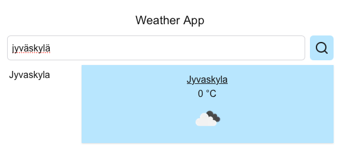
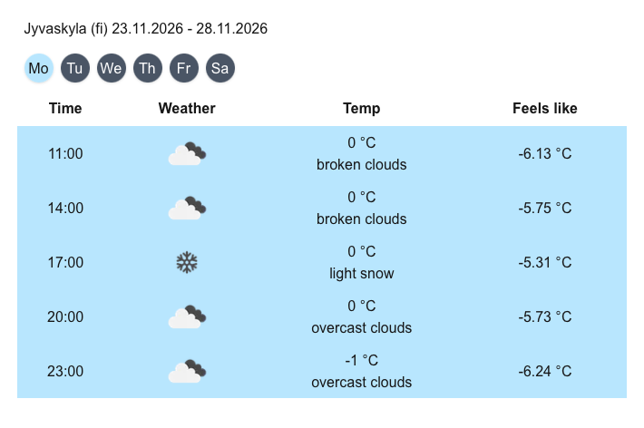

# Weather App
Search the current weather and a 5-day forecast for any city.

**Live demo:** [https://YOUR-APP.vercel.app ](https://weather-9dwiur6jp-quikkamedia.vercel.app)




## Features

- Search any city and see the current weather
- 5-day forecast with day tabs (3-hour intervals)
- Search history saved in the browser (localStorage)
- Handles loading, error and "city not found" states
- Responsive layout and dark mode support
- Lighthouse: Performance 98, Accessibility 100, Best Practices 100, SEO 100

## Tech stack

- Next.js 16 (App Router), React 19, TypeScript
- Tailwind CSS v4
- OpenWeather API
- Deployed on Vercel

## How it works

- The API key stays on the server. Weather requests run in server code and a Server Action, so the key never reaches the browser.
- API responses are cached for 10 minutes (`"use cache"`) to reduce API calls.
- A city is stored as `name,country` (for example `Rome,IT`) so cities with the same name stay separate.

## Run locally

```bash
git clone https://github.com/ollikor/weatherApp.git
cd weatherApp/weather-app
npm install
```

Create `.env.local` and add your own key from [openweathermap.org](https://openweathermap.org/api):

```
WEATHER_KEY=your_api_key
```

Then start the dev server and open http://localhost:3000:

```bash
npm run dev
```
